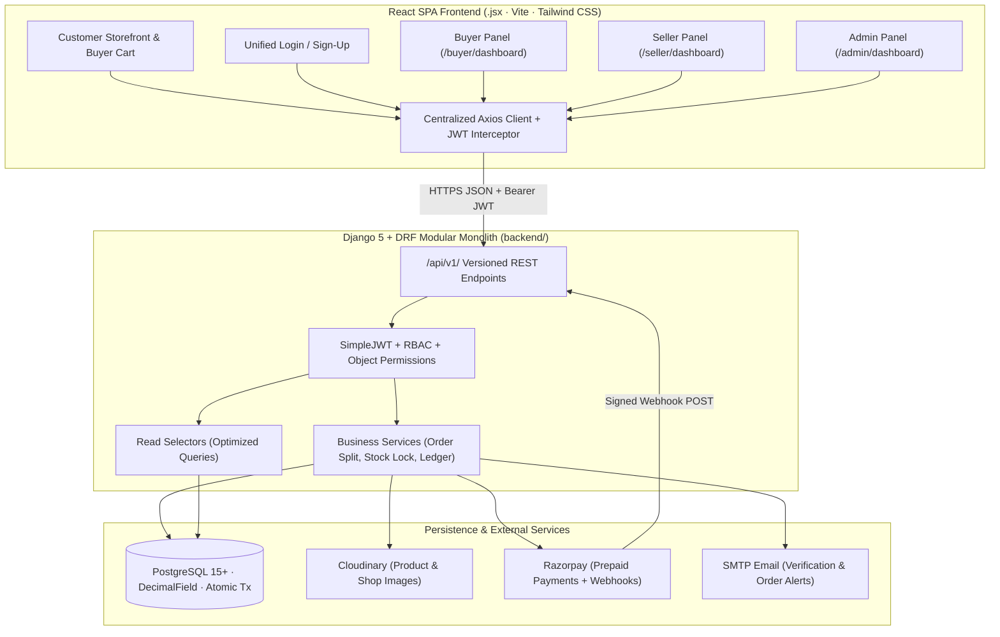
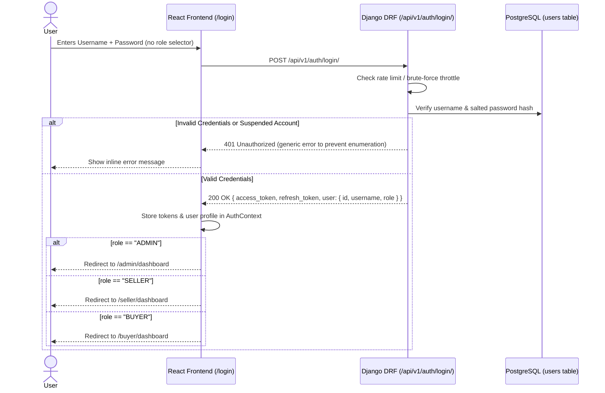
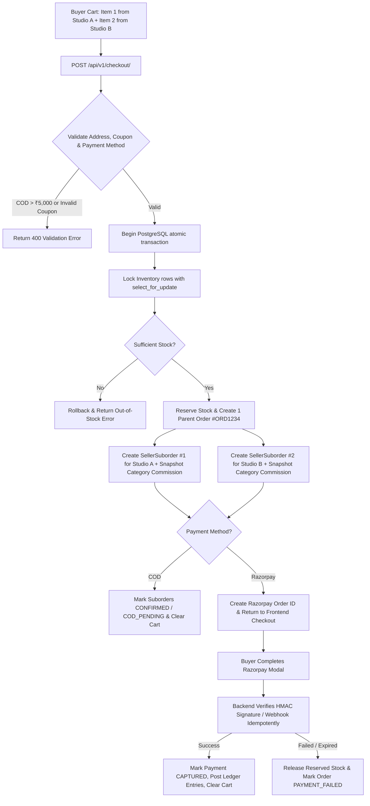
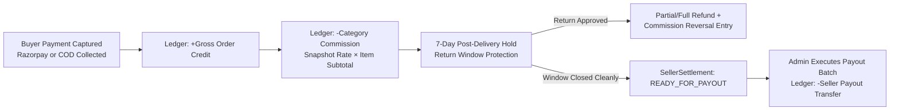

# 02. System Architecture, Folder Structures & Core Workflows

This document explains how Craftify's React frontend, Django REST backend, PostgreSQL database, and third-party services connect, along with beginner-friendly explanations of every major architectural decision.

---

## 1. High-Level System Architecture



---

## 2. Authentication & Automatic Role-Redirect Workflow



---

## 3. Multi-Vendor Order Splitting Workflow



---

## 4. Payment & Financial Ledger Workflow



---

## 5. Folder Structures (Monorepo Layout)

### 5.1 Frontend Structure (Repository Root — Vite + React `.jsx`)
Keeping React at the root preserves instant live previews while still letting you run `npm run dev` in VS Code.

```text
/ (Repository Root)
├── index.html                  # Fonts (Fraunces, Plus Jakarta Sans, JetBrains Mono) + entry
├── package.json                # React, React Router DOM, Axios, Recharts, Tailwind CSS
├── vite.config.ts              # Vite + Tailwind plugin + static asset bundler
├── .env.example                # VITE_API_BASE_URL, VITE_RAZORPAY_KEY_ID
├── docs/                       # Part 25 architecture, SRS, ERD, API & roadmap docs
└── src/
    ├── assets/images/          # Generated high-res craft imagery
    ├── components/
    │   ├── common/             # CraftifyLogo, EmptyState, Toast, PriceDisplay
    │   ├── storefront/         # StorefrontNavbar, HeroBanner, ProductCard, CategoryCard
    │   └── dashboards/         # DashboardShell (Dark Sidebar + Teal Active), KpiCard
    ├── context/                # AuthContext.jsx, CartContext.jsx
    ├── data/                   # Starter catalog & dashboard preview data (dev fallback)
    ├── pages/
    │   ├── StorefrontPage.jsx  # Customer Homepage (Hero, Trust Strip, Categories, Featured)
    │   ├── CartPage.jsx        # Buyer Cart (Qty steppers, Coupon, Order Summary)
    │   ├── LoginPage.jsx       # Strict Login UI (Username, Password, Sign Up link only)
    │   ├── SignUpPage.jsx      # Public Buyer Registration
    │   └── BecomeSellerPage.jsx# Buyer → Seller Application workflow
    ├── admin/
    │   └── AdminDashboard.jsx  # Admin Panel (KPIs, Sales Line Chart, Approvals, Donut, Orders)
    ├── seller/
    │   └── SellerDashboard.jsx # Seller Panel (KPIs, 6M Bar Chart, Orders, Your Shop, Actions)
    ├── buyer/
    │   └── BuyerDashboard.jsx  # Buyer Account (Orders, Tracking, Wishlist, Addresses)
    ├── routes/
    │   └── ProtectedRoute.jsx  # Role-based route guard (UX layer; backend enforces security)
    ├── services/
    │   ├── apiClient.js        # Centralized Axios instance + JWT refresh interceptor
    │   └── authService.js      # Auth API calls + backend health check
    ├── utils/
    │   └── formatters.js       # Indian INR formatting (₹2,45,000) & date helpers
    ├── App.jsx                 # Route definitions for Storefront, Auth & 3 Role Panels
    ├── main.jsx                # React root mount
    └── index.css               # Tailwind v4 + Craftify custom theme tokens
```

### 5.2 Backend Structure (`backend/` — Django 5 + DRF + PostgreSQL)

```text
backend/
├── manage.py
├── .env.example                # DB credentials, SECRET_KEY, Razorpay, Cloudinary keys
├── requirements/
│   ├── base.txt                # Django, DRF, SimpleJWT, psycopg, cors-headers, razorpay
│   ├── dev.txt                 # Includes base.txt + pytest/coverage/ruff tools
│   └── prod.txt                # Includes base.txt + gunicorn, whitenoise, sentry-sdk
├── config/
│   ├── settings/
│   │   ├── base.py             # Shared settings, custom User model, DRF, JWT, logging
│   │   ├── dev.py              # Local PostgreSQL/SQLite fallback, CORS localhost:3000
│   │   └── prod.py             # Strict HTTPS, Secure Cookies, Allowed Hosts, HSTS
│   ├── urls.py                 # Mounts /api/v1/ modular app routes
│   ├── wsgi.py
│   └── asgi.py
├── common/
│   ├── models.py               # TimeStampedModel, UUIDModel abstract base classes
│   ├── permissions.py          # IsAdminUserRole, IsApprovedSeller, IsBuyerRole, IsSuborderOwner
│   ├── pagination.py           # StandardCraftifyPagination
│   └── views.py                # /api/v1/health/ database & service check endpoint
└── apps/
    ├── accounts/               # Custom User model, JWT Login/Register, create_initial_admin cmd
    ├── sellers/                # SellerApplication, VerificationDocs, SellerProfile
    ├── categories/             # Hierarchical Categories + Category Commission Rates
    ├── products/               # Products, Variants, Images, Approval workflow, Inventory
    ├── cart/                   # Cart, CartItem, Wishlist, WishlistItem
    ├── coupons/                # Platform & Seller Coupons + Usage tracking
    ├── orders/                 # Parent Order, SellerSuborder, OrderItem snapshots
    ├── payments/               # Razorpay order/verify/webhook + COD tracking
    ├── shipping/               # Shipments, Courier tracking, ShipmentEvents, Returns
    ├── finance/                # FinancialLedgerEntry, Commissions, Settlements, Payouts
    ├── reviews/                # Verified purchase product reviews & seller ratings
    ├── notifications/          # In-app & email notification records
    └── support/                # SupportTickets, Disputes, AuditLogs, WebsiteSettings
```

---

## 6. Key Architectural Decisions (ADRs)

### ADR-01: Modular Monolith in Django (Not Microservices)
- **What**: A single Django backend split cleanly into 13 domain apps (`accounts`, `orders`, `finance`, etc.) with thin views and dedicated `services.py` business logic.
- **Why**: Multi-vendor checkouts need ACID transactions across inventory, parent orders, suborders, and payments in one PostgreSQL database. Microservices would add distributed-transaction failure modes and operational overhead with zero benefit at launch.
- **How**: Each app exposes clear service functions; cross-app mutations occur inside `transaction.atomic()`.
- **Alternatives**: Microservices (FastAPI/Django split), Serverless functions.
- **Timing**: **Initial Release (Mandatory)**.

### ADR-02: Dual-Workspace Monorepo (React Root + `backend/` Django)
- **What**: Single GitHub repository housing React at root and Django in `backend/`.
- **Why**: Lets you preview the React UI live immediately and pull the entire full-stack codebase into VS Code with a single `git pull`.
- **How**: React talks to Django via `VITE_API_BASE_URL=http://127.0.0.1:8000/api/v1` with CORS enabled for `localhost:3000`.
- **Alternatives**: Separate GitHub repos for frontend and backend (harder to keep API contracts synchronized during learning).
- **Timing**: **Initial Release (Mandatory)**.

### ADR-03: JWT Authentication (SimpleJWT) with Refresh Rotation
- **What**: Short-lived JWT access tokens + rotating refresh tokens stored cleanly with server-side blacklist on logout.
- **Why**: Works reliably across separate frontend (Vercel) and backend (Render) domains without brittle cross-site session cookie issues.
- **How**: `djangorestframework-simplejwt` issues tokens; Axios interceptors refresh expired access tokens automatically. For production hardening, refresh tokens can be upgraded to `HttpOnly; Secure; SameSite=Lax` cookies.
- **Alternatives**: Django Session Auth (simpler on same-origin, trickier on split Vercel/Render hosting).
- **Timing**: **Initial Release (Mandatory)**; HttpOnly cookie transport hardening in **Week 12 Security Pass**.

### ADR-04: Redis + Celery Deferred Until Async Volume Justifies It
- **What**: Keep initial development synchronous (Django + PostgreSQL) while writing clean service interfaces for emails and webhooks.
- **Why**: Avoids blocking a beginner setup with Redis/Celery worker configuration in Week 1–6.
- **How**: Abstract email/notification triggers inside `apps/notifications/services.py` so adding Celery `.delay()` later is a one-line swap.
- **Alternatives**: Setting up Docker + Redis + Celery on Day 1.
- **Timing**: **Future Enhancement (Week 11+ / Post-MVP scale)**.
