# 03. Database Entity-Relationship Diagram (ERD) & Schema Specification

Craftify uses **PostgreSQL 15+** managed via Django ORM migrations. Every monetary column uses `DecimalField(max_digits=12, decimal_places=2)` — floating-point types (`FloatField`) are strictly prohibited for money or commission math.

---

## 1. Complete Entity-Relationship Diagram (Mermaid)

```mermaid
erDiagram
    USERS ||--o{ BUYER_ADDRESSES : "has"
    USERS ||--o{ SELLER_APPLICATIONS : "submits"
    USERS ||--o| SELLER_PROFILES : "owns when approved"
    SELLER_APPLICATIONS ||--o{ SELLER_VERIFICATION_DOCS : "attaches"

    CATEGORIES ||--o{ CATEGORIES : "parent_category"
    CATEGORIES ||--o{ PRODUCTS : "classifies"
    SELLER_PROFILES ||--o{ PRODUCTS : "lists"
    PRODUCTS ||--o{ PRODUCT_IMAGES : "displays"
    PRODUCTS ||--o{ PRODUCT_VARIANTS : "offers"
    PRODUCT_VARIANTS ||--|| INVENTORY : "tracks"
    INVENTORY ||--o{ INVENTORY_TRANSACTIONS : "logs"

    USERS ||--|| CARTS : "owns"
    CARTS ||--o{ CART_ITEMS : "contains"
    PRODUCT_VARIANTS ||--o{ CART_ITEMS : "selected in"
    USERS ||--|| WISHLISTS : "owns"
    WISHLISTS ||--o{ WISHLIST_ITEMS : "saves"
    PRODUCTS ||--o{ WISHLIST_ITEMS : "bookmarked"

    COUPONS ||--o{ COUPON_USAGES : "redeemed via"
    USERS ||--o{ COUPON_USAGES : "uses"

    USERS ||--o{ ORDERS : "places"
    ORDERS ||--o{ SELLER_SUBORDERS : "splits into"
    SELLER_PROFILES ||--o{ SELLER_SUBORDERS : "fulfils"
    SELLER_SUBORDERS ||--o{ ORDER_ITEMS : "contains snapshots"
    SELLER_SUBORDERS ||--o{ SHIPMENTS : "ships via"
    SHIPMENTS ||--o{ SHIPMENT_EVENTS : "records"
    SELLER_SUBORDERS ||--o{ RETURNS : "may receive"
    RETURNS ||--o| REFUNDS : "triggers"

    ORDERS ||--o{ PAYMENTS : "paid by"
    PAYMENTS ||--o{ PAYMENT_TRANSACTIONS : "audits"
    SELLER_SUBORDERS ||--o{ COMMISSIONS : "incurs"
    SELLER_PROFILES ||--o{ FINANCIAL_LEDGER_ENTRIES : "tracks balance"
    SELLER_PROFILES ||--o{ SELLER_SETTLEMENTS : "matures into"
    SELLER_SETTLEMENTS }o--|| PAYOUTS : "batched into"

    USERS ||--o{ REVIEWS : "writes"
    PRODUCTS ||--o{ REVIEWS : "receives"
    USERS ||--o{ NOTIFICATIONS : "receives"
    USERS ||--o{ SUPPORT_TICKETS : "opens"
    ORDERS ||--o{ DISPUTES : "escalates"
    USERS ||--o{ AUDIT_LOGS : "triggers"
```

---

## 2. Detailed Table Specifications & Deletion Policies

### 2.1 Identity & Seller Onboarding (`apps/accounts`, `apps/sellers`)

| Table | Key Columns | Constraints & Indexes | Deletion Policy |
| :--- | :--- | :--- | :--- |
| **users** | `id (UUID PK)`, `username (unique)`, `email (unique)`, `full_name`, `role (ADMIN/SELLER/BUYER)`, `is_email_verified`, `is_active`, `created_at` | Index on `(role, is_active)`, unique lowercase email & username | Soft-deactivate (`is_active=False`); never hard-delete users with orders |
| **buyer_addresses** | `id`, `user_id (FK)`, `recipient_name`, `phone`, `line1`, `line2`, `city`, `state`, `pincode`, `is_default` | Check 6-digit Indian pincode; index on `user_id` | `CASCADE` on user delete (orders store address JSON snapshot) |
| **seller_applications** | `id`, `user_id (FK)`, `shop_name`, `bio`, `city`, `state`, `pan_number`, `gstin (nullable)`, `status (PENDING/APPROVED/REJECTED)`, `reviewed_by (FK)`, `review_notes` | Index on `status` | `PROTECT` |
| **seller_verification_docs** | `id`, `application_id (FK)`, `doc_type`, `file_url`, `verified_at` | Index on `application_id` | `CASCADE` |
| **seller_profiles** | `id`, `user_id (1:1)`, `shop_name (unique)`, `slug (unique)`, `description`, `logo_url`, `banner_url`, `pickup_address_json`, `bank_account_masked`, `ifsc_code`, `agreement_accepted_at`, `is_suspended`, `rating_avg` | Index on `(slug, is_suspended)` | `PROTECT` (preserves historical orders & financial ledger) |

### 2.2 Categories, Products & Inventory (`apps/categories`, `apps/products`)

| Table | Key Columns | Constraints & Indexes | Deletion Policy |
| :--- | :--- | :--- | :--- |
| **categories** | `id`, `name`, `slug (unique)`, `parent_id (self FK nullable)`, `commission_rate (Decimal 5,2)`, `is_active` | Check `0 <= commission_rate <= 50`; index on `slug` | `PROTECT` while products exist |
| **products** | `id (UUID)`, `seller_id (FK)`, `category_id (FK)`, `title`, `slug (unique)`, `description`, `base_price (Decimal)`, `discount_price (Decimal nullable)`, `processing_days`, `is_customizable`, `is_made_to_order`, `is_one_of_a_kind`, `approval_status (PENDING/APPROVED/REJECTED)`, `is_deleted` | Check `base_price > 0`, `discount_price < base_price`; composite index `(approval_status, category_id, is_deleted)` | Soft-delete (`is_deleted=True`) so old order references remain intact |
| **product_images** | `id`, `product_id (FK)`, `image_url`, `cloudinary_public_id`, `alt_text`, `sort_order`, `is_primary` | Index on `(product_id, sort_order)` | `CASCADE` |
| **product_variants** | `id`, `product_id (FK)`, `sku (unique)`, `size`, `color`, `material`, `price_override (Decimal nullable)`, `weight_grams`, `dimensions_cm` | Unique `(product_id, sku)` | Soft-deactivate |
| **inventory** | `id`, `variant_id (1:1)`, `quantity_available (Int)`, `quantity_reserved (Int)`, `updated_at` | Check `quantity_available >= 0` & `quantity_reserved >= 0` | `CASCADE` |
| **inventory_transactions** | `id`, `inventory_id (FK)`, `change_type (RESTOCK/RESERVE/RELEASE/DEDUCT/RETURN)`, `quantity_delta`, `reference_order_id`, `created_at` | Index on `(inventory_id, created_at)` | Immutable (`PROTECT`) |

### 2.3 Shopping & Promotions (`apps/cart`, `apps/coupons`)

| Table | Key Columns | Constraints & Indexes | Deletion Policy |
| :--- | :--- | :--- | :--- |
| **carts / cart_items** | `cart_id`, `user_id (1:1)`, `variant_id (FK)`, `quantity`, `customization_note` | Unique `(cart_id, variant_id)`, check `quantity > 0` | `CASCADE` |
| **wishlists / wishlist_items** | `wishlist_id`, `user_id (1:1)`, `product_id (FK)` | Unique `(wishlist_id, product_id)` | `CASCADE` |
| **coupons / coupon_usages** | `code (unique)`, `scope (PLATFORM/SELLER)`, `seller_id (nullable)`, `discount_type (PERCENT/FIXED)`, `value (Decimal)`, `min_order_amount`, `max_discount_amount`, `valid_from`, `valid_until`, `max_uses`, `used_count` | Check `valid_until > valid_from`, index on `code` | `PROTECT` once redeemed |

### 2.4 Multi-Vendor Orders & Shipping (`apps/orders`, `apps/shipping`)

| Table | Key Columns | Constraints & Indexes | Deletion Policy |
| :--- | :--- | :--- | :--- |
| **orders** | `id (UUID)`, `order_number (unique, e.g. ORD1234)`, `buyer_id (FK)`, `shipping_address_snapshot (JSONB)`, `subtotal_amount`, `shipping_amount`, `discount_amount`, `total_amount (Decimal)`, `payment_method (RAZORPAY/COD)`, `payment_status`, `overall_status`, `created_at` | Index on `(buyer_id, created_at DESC)`, unique `order_number` | **NEVER DELETE** (`PROTECT`) |
| **seller_suborders** | `id (UUID)`, `parent_order_id (FK)`, `seller_id (FK)`, `suborder_number (unique)`, `seller_shop_name_snapshot`, `subtotal_amount`, `shipping_share`, `commission_amount`, `net_seller_amount (Decimal)`, `fulfilment_status (PENDING/ACCEPTED/PACKED/SHIPPED/DELIVERED/CANCELLED/RETURNED)`, `delivered_at` | Index on `(seller_id, fulfilment_status)`, `(parent_order_id)` | **NEVER DELETE** (`PROTECT`) |
| **order_items** | `id`, `suborder_id (FK)`, `product_id (FK nullable)`, `variant_id (FK nullable)`, `product_title_snapshot`, `variant_label_snapshot`, `unit_price_snapshot`, `commission_rate_snapshot`, `quantity`, `line_total`, `customization_note` | Check `quantity > 0`, `line_total >= 0` | **NEVER DELETE** (`PROTECT`) |
| **shipments / shipment_events** | `id`, `suborder_id (FK)`, `courier_name`, `tracking_number`, `tracking_url`, `shipped_at`, `estimated_delivery_date`, `delivered_at`; events: `status`, `location`, `notes`, `timestamp` | Index on `(suborder_id)`, `tracking_number` | `PROTECT` |
| **returns / refunds** | `return_id`, `suborder_id (FK)`, `order_item_id (FK)`, `reason`, `evidence_urls`, `status (REQUESTED/APPROVED/PICKED_UP/REFUNDED/REJECTED)`, `refund_amount (Decimal)`, `razorpay_refund_id`, `processed_at` | Check `refund_amount > 0` | `PROTECT` |

### 2.5 Financial Ledger & Payments (`apps/payments`, `apps/finance`)

| Table | Key Columns | Constraints & Indexes | Deletion Policy |
| :--- | :--- | :--- | :--- |
| **payments** | `id`, `order_id (FK)`, `provider (RAZORPAY/COD)`, `razorpay_order_id (unique nullable)`, `razorpay_payment_id (unique nullable)`, `amount (Decimal)`, `currency (INR)`, `status (CREATED/AUTHORIZED/CAPTURED/FAILED/REFUNDED)` | Unique constraints on Razorpay IDs prevent duplicate processing | `PROTECT` |
| **payment_transactions** | `id`, `payment_id (FK)`, `idempotency_key (unique)`, `webhook_event_id (unique nullable)`, `event_type`, `raw_payload (JSONB redacted)`, `created_at` | Unique `webhook_event_id` guarantees idempotent webhooks | `PROTECT` |
| **commissions** | `id`, `suborder_id (1:1)`, `category_rate_snapshot`, `gross_amount`, `commission_amount`, `reversed_amount` | Check `commission_amount >= 0` | `PROTECT` |
| **financial_ledger_entries** | `id`, `seller_id (FK nullable)`, `order_id (FK nullable)`, `suborder_id (FK nullable)`, `entry_type (SALE_CREDIT/COMMISSION_DEBIT/REFUND_DEBIT/COMMISSION_REVERSAL/PAYOUT_DEBIT)`, `amount (Decimal)`, `balance_after (Decimal)`, `reference_key (unique)`, `created_at` | **Append-only**; unique `reference_key` prevents double posting | **NEVER UPDATE OR DELETE** |
| **seller_settlements / payouts** | `settlement_id`, `suborder_id (1:1)`, `seller_id (FK)`, `eligible_at (delivered_at + 7 days)`, `net_amount`, `status (HOLDING/READY/PAID)`; `payout`: `batch_ref`, `total_amount`, `utr_number`, `paid_at` | Index on `(seller_id, status, eligible_at)` | `PROTECT` |

### 2.6 Engagement & Administration (`apps/reviews`, `apps/notifications`, `apps/support`)

- **reviews**: `product_id`, `buyer_id`, `order_item_id`, `rating (1–5 Check)`, `comment`, `is_verified_purchase`, unique `(buyer_id, order_item_id)`.
- **notifications**: `user_id`, `title`, `message`, `category`, `is_read`, `action_url`, `created_at`.
- **support_tickets & disputes**: `ticket_number`, `user_id`, `order_id (nullable)`, `subject`, `status`, `assigned_admin_id`.
- **audit_logs**: `actor_id`, `action`, `target_model`, `target_id`, `metadata_json`, `ip_address`, `created_at` (immutable security trail).
- **website_settings**: Key-value configuration (`free_shipping_threshold=999.00`, `cod_max_amount=5000.00`, `return_window_days=7`).

---

## 3. Concurrency & Integrity Safeguards

1. **Preventing Overselling**: During checkout, Django runs `Inventory.objects.select_for_update().filter(variant_id__in=variant_ids).order_by('id')` inside `transaction.atomic()`. Ordering by `id` prevents PostgreSQL deadlocks when two buyers purchase overlapping items simultaneously.
2. **Historical Accuracy**: Even if a seller renames a ceramic vase or increases its price from ₹1,499 to ₹1,899 tomorrow, `order_items` retains `product_title_snapshot` and `unit_price_snapshot` permanently.
3. **Zero Float Drift**: Every price, discount, GST breakdown, category commission, and settlement uses Python `Decimal` and PostgreSQL `NUMERIC(12,2)`.
