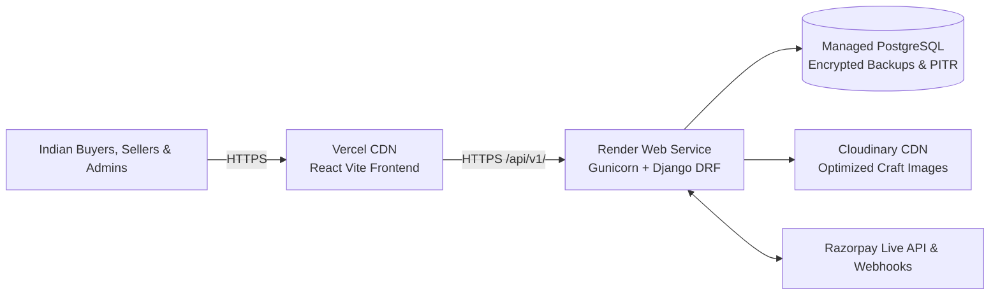

# 05. Security Architecture, Testing Strategy, Deployment & 12-Week Roadmap

---

## 1. Security Architecture (OWASP ASVS Baseline)

| Threat / Control | Craftify Implementation |
| :--- | :--- |
| **SQL Injection** | Strictly use Django ORM parameterized queries; never concatenate raw SQL strings. |
| **Broken Access Control / IDOR** | Every Seller & Buyer queryset filters by `request.user` (`SellerSuborder.objects.filter(seller__user=request.user)`). Explicit `IsAdminRole` and `IsApprovedSeller` DRF permission classes. |
| **Privilege Escalation** | Public `/api/v1/auth/register/` ignores any `role` field sent in JSON and forces `role=User.Role.BUYER`. Admin accounts are created only via CLI management command. |
| **Brute-Force & Account Enumeration** | DRF ScopedRateThrottle on `/auth/login/` (e.g., 5 attempts/minute per IP/user) and identical error messages (`"Invalid username or password"`). |
| **Payment Tampering & Replay** | Verify Razorpay HMAC SHA-256 signature on backend; reject duplicate webhooks via unique `webhook_event_id` in `payment_transactions`. Never trust frontend payment success callbacks alone. |
| **XSS & CSRF & Clickjacking** | React automatic escaping, DRF JSON-only APIs, strict `CORS_ALLOWED_ORIGINS`, `X-Frame-Options: DENY`, `SECURE_CONTENT_TYPE_NOSNIFF`, and Content Security Policy headers in production. |
| **Malicious File Uploads** | Validate file extension, MIME magic bytes, and size limits (≤ 5MB) before uploading images to Cloudinary. |
| **Secret Hygiene** | Zero secrets committed to Git; all credentials loaded from `.env` locally and platform secret managers on Vercel/Render. Sensitive fields (`password`, `token`, `razorpay_signature`) scrubbed from logs. |

---

## 2. Testing Strategy

No module is marked complete until its test suite runs and passes locally in VS Code:

1. **Unit Tests (Django `TestCase`)**: Model constraints, `DecimalField` category commission math, coupon validation, return-window eligibility (`delivered_at + 7 days`), password hashing.
2. **Integration Tests (DRF `APITestCase`)**: Auth login/redirect payload, public signup role lock, Seller application → Admin approval → Product approval flow, multi-vendor checkout splitting, Razorpay signature/webhook idempotency.
3. **Security Tests**: Attempt Buyer accessing `/api/v1/admin/*` (`403`), Seller A accessing Seller B's suborder (`403`/`404`), public signup attempting `role: "ADMIN"` (ignored / forced `BUYER`), expired JWT rejection (`401`).
4. **Concurrency & Business Logic Tests**: Two simultaneous checkouts competing for last 1 unit in stock (row locking prevents negative stock), partial refund reversing proportional commission.
5. **Frontend Tests**: React component rendering, form validation on Login/Sign-Up, cart quantity/coupon calculations, and route-guard redirects.

---

## 3. Production Deployment Architecture

### Deployment Checklist (Week 12)
- Separate `development`, `staging`, and `production` environment configs.
- `DEBUG=False`, strict `ALLOWED_HOSTS`, `SECURE_SSL_REDIRECT=True`, `SECURE_HSTS_SECONDS=31536000`.
- `CORS_ALLOWED_ORIGINS` locked to the exact Vercel frontend domain.
- Automated daily encrypted PostgreSQL backups with documented quarterly restore test.
- Rollback plan: immutable Git tags + Render one-click deploy rollback + backwards-compatible Django migrations.

---

## 4. Target 12-Week Incremental Roadmap

> This is a structured target roadmap; each week completes backend models/APIs, frontend integration, and verification tests before moving on.

| Week | Module Focus | Key Deliverables |
| :---: | :--- | :--- |
| **1** | **SRS, Architecture, ERD & UI/UX Blueprint** | All 20 Part 25 documentation deliverables in `docs/` + 4-screen visual design baseline *(Completed in Milestone 1)* |
| **2** | **React (`.jsx`), Django & PostgreSQL Setup** | Dual-workspace monorepo, Vite + Tailwind + Router + Axios, Django 5 + DRF + SimpleJWT starter, `/api/v1/health/` *(Completed in Milestone 1)* |
| **3** | **Authentication & Role Permissions** | Full JWT login/logout/refresh rotation, rate limiting, email verification, password reset, strict `/login` & `/sign-up` integration |
| **4** | **Admin Panel & Seller Onboarding** | "Become a Seller" application + verification docs, Admin approval/rejection workflow, role promotion & audit logs |
| **5** | **Categories & Product Management** | Category CRUD with commission %, Seller product/variant/Cloudinary upload, Admin product moderation queue |
| **6** | **Customer Shopping Storefront** | Live product catalog, search, category/price/rating filters, sorting, Product Detail Page (PDP) with variants & customization |
| **7** | **Cart, Wishlist & Checkout** | Persistent Cart & Wishlist APIs, Coupon engine, Buyer Addresses, free-shipping threshold (₹999), checkout validation |
| **8** | **Multi-Vendor Orders, Razorpay & COD** | Atomic stock locking, Parent `Order` + `SellerSuborder` splitting, Razorpay signature & idempotent webhook verification, COD cap |
| **9** | **Shipping, Tracking & 7-Day Returns** | Seller suborder fulfilment, courier/tracking updates, shipment timeline events, 7-day return eligibility & partial cancellation |
| **10** | **Commissions, Refunds & Payouts** | Append-only `FinancialLedgerEntry`, commission calculations & reversals, 7-day settlement hold, Admin payout batches & reports |
| **11** | **Reviews, Notifications & Analytics** | Verified-purchase reviews, seller ratings, email/in-app notifications, real database-backed Admin & Seller analytics charts |
| **12** | **Testing, Security Hardening & Deployment** | Full OWASP security verification, concurrency tests, Vercel + Render + Managed PostgreSQL + Cloudinary production deploy |

---

## 5. Project Progress Tracker

### Completed (Milestone 1 — Blueprint & Starter Foundation)
- [x] Complete Part 25 Documentation Suite (`docs/01` through `docs/05`)
- [x] Root `README.md` with GitHub → VS Code step-by-step setup guide
- [x] Django 5 + DRF + PostgreSQL modular backend scaffold (`backend/`) with custom `User` model, JWT endpoints, `/api/v1/health/`, `create_initial_admin` command, and starter unit tests
- [x] React (`.jsx`) starter storefront, Buyer Cart, strict Login/Sign-Up pages, and Admin/Seller/Buyer dashboard shells matching the 4-screen Craftify UI/UX mockup

### Next Recommended Module
- **Week 3 (Module 1 — Full Authentication & Permissions)**: Connect your local PostgreSQL database in VS Code, run `python manage.py migrate` and `python manage.py test`, verify live login from React → Django, and then implement email verification, password reset, and login rate limiting.
